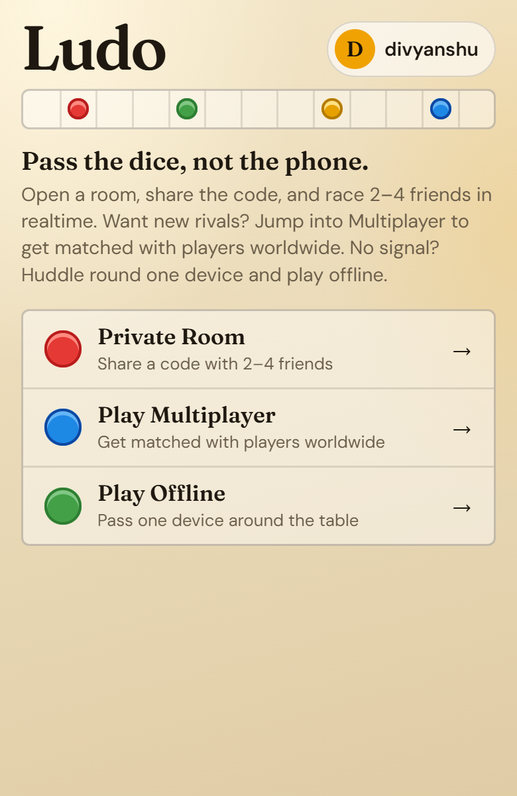
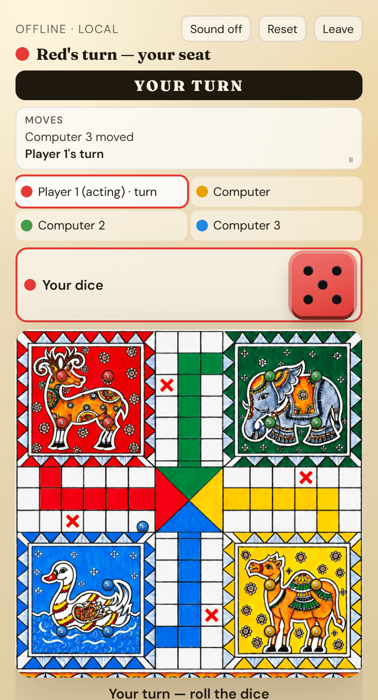
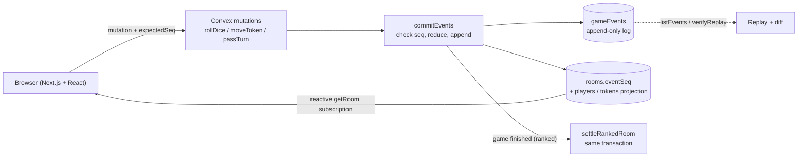

# Family Ludo

[](https://github.com/Divyanshusinha01/ludo/actions/workflows/ci.yml)
[](LICENSE)

Realtime online Ludo for phones, for 2 to 4 players. Built with Next.js and Convex. The server owns all game state, and every state change is written to an append-only event log that can be replayed to rebuild the game. Play as a guest with a room code, or sign in for ranked matchmaking with Elo ratings, match history, a leaderboard and live spectating.

**Live demo: [ludo-three-steel.vercel.app](https://ludo-three-steel.vercel.app)**

<p>
  
  
</p>

## Try it as a guest

No account is needed.

1. Open the [live demo](https://ludo-three-steel.vercel.app) on a phone or desktop.
2. Tap **Private Room**, then **Create Game**. Pick 1v1 or 2v2 Team, enter a name and tap **Create game**.
3. In the lobby, share the 6-character code with friends, or tap **Add computer** to fill seats with bots.
4. Start the game. On your turn, roll the dice and tap a glowing token to move.

**Play Offline** on the home screen runs a pass-and-play game on one device with no network.

## Engineering highlights

Each item below is implemented in the linked code and covered by the linked tests. On 2026-10-11, `npm run test:coverage` passed all 730 tests in 62 files locally, with 82.52% line coverage of `convex/` and `src/lib/` (Vitest 4). Every measured number, with its command, date and machine, is in [docs/quality.md](docs/quality.md).

- **Event-sourced, server-authoritative game state.** Every roll, move, timeout and forfeit is a typed event appended to the `gameEvents` table by `commitEvents` in [`convex/lib/gameStore.ts`](convex/lib/gameStore.ts). The live room tables are a projection of that log.
- **Deterministic replay.** The reducer in [`convex/lib/game/`](convex/lib/game) is pure: dice values are rolled once on the server and stored in the event, so replaying the log always produces the same state. [`internal.gameEvents.verifyReplay`](convex/gameEvents.ts) replays a room and diffs it against the live state. Tests: [`tests/game/replay/determinism.test.ts`](tests/game/replay/determinism.test.ts) (the reducer never reads `Math.random` or `Date.now`), [`tests/convex/live-vs-replay.test.ts`](tests/convex/live-vs-replay.test.ts) (live state equals replayed state after every action of full 1v1, 3-player, 4-player and 2v2 games), [`tests/game/replay/corrupted-history.test.ts`](tests/game/replay/corrupted-history.test.ts) and [`tests/convex/verify-replay.test.ts`](tests/convex/verify-replay.test.ts) (dropped, swapped, duplicated or truncated events are detected).
- **Optimistic concurrency with `expectedSeq`.** Each gameplay mutation carries the room version the client saw. A mismatch, or a log tail that does not match the head, rejects the call and Convex rolls back every write. Double clicks, duplicate deliveries and two players acting at once land exactly once. Tests: [`tests/convex/concurrency/`](tests/convex/concurrency) (races, stale and duplicate calls, matchmaking races, reconnect storms) and [`tests/convex/versioning.test.ts`](tests/convex/versioning.test.ts).
- **Idempotent ranked settlement.** `settleRankedRoom` in [`convex/lib/settlement.ts`](convex/lib/settlement.ts) runs inside the same transaction as the move that ends the game. A `ratingSettledAt` guard makes a second call a no-op, and abandoned games close without moving ratings. Tests: [`tests/convex/rating-settlement.test.ts`](tests/convex/rating-settlement.test.ts) (settles exactly once, duel, free-for-all, 2v2, abandoned games).
- **Elo for duels, free-for-all and teams.** [`convex/lib/rating.ts`](convex/lib/rating.ts): K-factor 40 for the first 30 rated games, then 24. Free-for-all is pairwise Elo over final placements scaled by 1/(n-1); 2v2 uses team-average ratings. Matchmaking accepts opponents within +/-100 rating, widening by 50 every 10s up to +/-500. Tests: [`tests/rating.test.ts`](tests/rating.test.ts), [`tests/convex/matchmaking.test.ts`](tests/convex/matchmaking.test.ts).
- **Reconnects without refreshing.** The client sends a heartbeat every 20s ([`src/hooks/useRoomPresence.ts`](src/hooks/useRoomPresence.ts)); the server ignores heartbeats sent less than 5s apart, and [`cleanup.tick`](convex/cleanup.ts) (every 30s) marks a seat away after 45s of silence. A client reconnecting with an old view is refused as stale and converges through its live subscription or `listEvents({ afterSeq })`. Server-side tests: [`tests/convex/reconnect-convergence.test.ts`](tests/convex/reconnect-convergence.test.ts), [`tests/convex/concurrency/reconnect-storm.test.ts`](tests/convex/concurrency/reconnect-storm.test.ts). In the browser, [`e2e/reconnect.spec.ts`](e2e/reconnect.spec.ts) takes one player offline while the other plays, then checks that the dropped player catches up and acts again without a page reload. The "Board updated" banner itself is not asserted in a browser test.
- **Room isolation.** Rooms played in parallel keep separate logs, and a player in one room cannot act in another. Test: [`tests/convex/room-isolation.test.ts`](tests/convex/room-isolation.test.ts).
- **Browser E2E and accessibility.** Seven Playwright specs in [`e2e/`](e2e) run against a production build and a local Convex backend: a bot game, two players in sync, reconnect, offline pass-and-play after the service worker installs, keyboard-only play, an axe scan of five screens with no serious or critical WCAG A/AA violations, and a check of the security headers with no Content Security Policy violations.
- **Load testing.** k6 scripts in [`load/k6/`](load/k6) drive the real Convex functions for gameplay and reconnect storms, and [`load/verify-replay.mjs`](load/verify-replay.mjs) runs `verifyReplay` on sampled rooms afterwards. On a single-laptop local backend, 5 rooms met the latency thresholds (p95 < 500ms, p99 < 1000ms). From 25 rooms up, latency failed, and from 50 rooms up, errors (HTTP 429/503) did too. Reconnect success stayed at or above 99.49% up to 100 rooms, and 59 of 59 checked rooms replayed with no diffs. Cloud Convex has not been load tested. Details: [docs/operations.md](docs/operations.md#measured-results).
- **CI.** [GitHub Actions](.github/workflows/ci.yml) audits production dependencies, then runs lint, type checks for the app and `convex/`, and a production build. Other jobs run the Vitest suites with coverage floors, the Playwright specs against a throwaway local Convex backend, and a gitleaks secret scan over the full history. Actions are pinned by commit SHA and [Dependabot](.github/dependabot.yml) proposes weekly updates.

## Architecture



## Design decisions

- **Server authority.** Clients only send intents. The server rolls the dice, validates the move with the reducer and commits events. A modified client cannot change the board or dice. See [`convex/game.ts`](convex/game.ts).
- **One version number per room.** `rooms.eventSeq` is the sequence number of the newest event and only ever increases, including across rematches. Stale calls are rejected rather than merged, because the reactive subscription already holds the newer state. See [`convex/lib/gameStore.ts`](convex/lib/gameStore.ts), tested in [`tests/convex/versioning.test.ts`](tests/convex/versioning.test.ts).
- **Settlement in the finishing transaction.** Ratings and match history are written in the same transaction as the move that ends the game, guarded by `ratingSettledAt` and `matches.by_room`. A retry or a duplicate finish cannot pay out twice. See [`convex/lib/settlement.ts`](convex/lib/settlement.ts), tested in [`tests/convex/rating-settlement.test.ts`](tests/convex/rating-settlement.test.ts).
- **Reconnects lean on Convex subscriptions.** The Convex client reconnects and re-subscribes on its own. The app adds presence heartbeats, disables input while the socket is down, and clears optimistic state on a stale rejection. The full model is in [docs/operations.md](docs/operations.md#reconnect-model).

More detail: [docs/operations.md](docs/operations.md) (version and reconnect model, metrics, the `/ops` dashboard, load tests, troubleshooting) and [docs/multiplayer.md](docs/multiplayer.md) (accounts and sessions, ranked queue lifecycle, rating formula, settlement, match history, spectators, schema deploys).

## Features

- Private rooms for 2 to 4 players with a shareable 6-character code, 1v1 or 2v2 team mode, and computer players
- Ranked matchmaking: 1v1 duel, 4-player free-for-all and 2v2, with Elo ratings, match history and a leaderboard
- Live spectating of ranked games in progress
- Offline pass-and-play on one device
- 3D dice and tokens (React Three Fiber) on a 2D board
- Optional username and password accounts; guests play without signing up
- Ops dashboard at `/ops` with latency, error and reconnect metrics
- Debug replay UI at `/debug/replay/[CODE]`

## How to play

1. One person taps **Private Room**, then **Create Game**, and shares the 6-character code (or uses Copy / share)
2. Others tap **Private Room**, then **Join Game**, and enter the code (2 to 4 players)
3. Host starts when at least two players are in the lobby
4. On your turn: roll the dice, tap a glowing token to move
5. After a win: **Play again** for a rematch, or go home

Ranked: sign in, open **Play Multiplayer**, pick a queue and tap **Find match**. You are matched with players of similar rating and the game starts automatically; your rating change shows when it ends and on your profile. Ranked games have no rematch, and leaving counts as a loss. **Watch live** lists ranked games in progress.

### Rules implemented

- Need a **6** to leave home
- Exact count to finish
- Capture opponents on non-safe cells (sent home)
- Safe cells: start squares + star cells
- **Barrier**: two tokens of the same colour on one cell cannot be captured or landed on. Tokens may still pass through a barrier cell mid-path (destination-only block)
- Extra turn on **6** or capture
- Three consecutive 6s skips the turn
- Away players are skipped after ~60s; leaving mid-game forfeits your seat (if only one player remains, they win)
- Finished rooms expire ~6h after the win; idle/abandoned playing rooms are cleaned up automatically
- Rematch is host-only and drops long-away seats
- First player to finish all four tokens wins

## Stack

- Next.js (App Router) + TypeScript
- React + CSS/SVG board, React Three Fiber for dice and tokens
- Convex (authoritative game state + realtime)
- Vercel for hosting
- Vitest (unit, Convex and UI projects), Playwright with axe for browser tests, k6 for load tests

## Local development

Prerequisites: Node.js 22 or later and npm. A Convex account is optional: `npx convex dev` can run an anonymous local backend. [k6](https://k6.io) is only needed for the load tests.

1. Install dependencies: `npm install`
2. Start Convex: `npx convex dev` (creates `.env.local` with `NEXT_PUBLIC_CONVEX_URL`)
3. In another terminal: `npm run dev`
4. Open [http://localhost:3000](http://localhost:3000)

### Environment variables

[`.env.local.example`](.env.local.example) lists the Next.js variables. Nothing is required beyond what `npx convex dev` writes; accounts and the debug pages are optional.

| Variable | Where it is set | Required | Purpose |
| --- | --- | --- | --- |
| `NEXT_PUBLIC_CONVEX_URL` | Next.js (`.env.local`, Vercel) | Yes | Convex deployment URL. Written by `npx convex dev` |
| `AUTH_JWT_PRIVATE_KEY` | Next.js | For accounts | RS256 private key (JWK) that signs Convex auth tokens |
| `AUTH_SERVER_SECRET` | Next.js and Convex (same value) | For accounts | Shared secret for server-to-server auth calls |
| `AUTH_JWKS` | Convex (`npx convex env set`) | For accounts | Public key set that Convex uses to verify tokens |
| `OPS_DASHBOARD_TOKEN` | Convex | For `/ops` | Token the ops dashboard asks for. Without it the dashboard query always refuses |
| `NEXT_PUBLIC_ENABLE_OPS_DASHBOARD` | Next.js | No | `1` enables `/ops` in production builds (always on in development) |
| `NEXT_PUBLIC_ENABLE_REPLAY_DEBUG` | Next.js | No | `1` enables `/debug/replay/[CODE]` in production builds (always on in development) |

`node scripts/generate-auth-keys.mjs` prints fresh values for the three `AUTH_*` variables. See [Accounts and environment](#accounts-and-environment).

### Event log and replay (dev)

Gameplay mutations append to the `gameEvents` table and require `expectedSeq` from the client (`room.eventSeq`). Legacy rooms without `eventSeq` are rejected - run `npx convex run legacy:purgeLegacyRooms` once after deploying the schema.

Turn expiry: if a command arrives after the turn clock, the server commits timeout events first and returns `turnExpired` on roll (no thrown mutation, so the timeout persists).

Debug replay UI: `/debug/replay/[CODE]` in development, or set `NEXT_PUBLIC_ENABLE_REPLAY_DEBUG=1` in production.

## Scripts

- `npm run dev` - Next.js frontend
- `npm run dev:convex` - Convex backend watcher
- `npm test` / `npm run test:logic` - all Vitest projects (unit, Convex, UI)
- `npm run test:unit` / `test:convex` / `test:concurrency` / `test:ui` - one project or folder
- `npm run test:watch` - Vitest watch mode
- `npm run test:coverage` - all Vitest projects with v8 coverage (fails under the floors in `vitest.config.mts`)
- `npm run test:e2e` - Playwright specs (builds into `.next-e2e`, reuses or starts `npx convex dev`, and refuses a non-local Convex URL)
- `npm run typecheck` - TypeScript for the app and `convex/`
- `npm run smoke:integration` - integration and security smoke checks against a running Convex deployment (reads `.env.local`; not part of CI)
- `npm run smoke:full-game` - plays one full game against a running Convex deployment (reads `.env.local`; not part of CI)
- `npm run load:gameplay` / `load:reconnect` - k6 load tests against the local backend (needs [k6](https://k6.io), `winget install k6`)
- `npm run load:verify` - `verifyReplay` on a sample of rooms after a load run
- `npm run build` - production Next.js build

## Accounts and environment

Accounts: run `node scripts/generate-auth-keys.mjs` and set the printed `AUTH_JWT_PRIVATE_KEY` + `AUTH_SERVER_SECRET` in the Next.js env (`.env.local` / Vercel) and `AUTH_JWKS` + the same `AUTH_SERVER_SECRET` in Convex (`npx convex env set ...`). Convex refuses to push `convex/auth.config.ts` until `AUTH_JWKS` is set on that deployment, so set it before the next `npx convex dev` / `npx convex deploy`. If the Next.js values are missing, anonymous play still works and the sign-in routes return 503.

## Operations

[docs/operations.md](docs/operations.md) covers the version and reconnect model, metrics and the `/ops` dashboard, k6 load tests with measured results, and troubleshooting.

[docs/quality.md](docs/quality.md) is the quality scorecard: test count, coverage, E2E, bot strength, load, replay and Lighthouse results, each with its command and date.

[docs/multiplayer.md](docs/multiplayer.md) covers accounts and sessions, the ranked queue lifecycle, the rating formula, settlement idempotency, match history, spectators, and deploying the (additive, no-backfill) schema.

Ops dashboard: `/ops` in development, or set `NEXT_PUBLIC_ENABLE_OPS_DASHBOARD=1` in production. It also needs the `OPS_DASHBOARD_TOKEN` Convex environment variable (`npx convex env set OPS_DASHBOARD_TOKEN <value>`).

## Deploy

A local anonymous Convex backend (`127.0.0.1`) is only reachable from the machine running it. To play from other devices, deploy the backend to Convex cloud:

```bash
# 1. Link a Convex cloud account (interactive once)
npx convex login

# 2. Create/link a cloud project and deploy backend
npx convex deploy

# 3. Note the production URL printed (also in the Convex dashboard)
# 4. Deploy frontend to Vercel with that URL:
npx vercel --prod
# Set NEXT_PUBLIC_CONVEX_URL to the Convex production URL in the Vercel project env
```

Or one-shot Convex+build:

```bash
npx convex deploy --cmd "npm run build"
```

Then import the repo in Vercel and set `NEXT_PUBLIC_CONVEX_URL`.

Manual checks for phones before a release are in [docs/mobile-qa.md](docs/mobile-qa.md).

## Privacy

Your session id stays in this device's browser storage and is never returned to other players in room queries. Session ids must be valid UUIDs; room creation is lightly rate-limited.

Accounts are optional. If you sign in, your password is stored only as a salted PBKDF2 hash and your session lives in an httpOnly cookie that page scripts cannot read. Other players and spectators see your display name, username and rating, never account or session ids.

## Contributing and security

Contributions are welcome; see [CONTRIBUTING.md](CONTRIBUTING.md). To report a vulnerability, follow [SECURITY.md](SECURITY.md) rather than opening a public issue.

## License

[MIT](LICENSE). This covers the code and the original board and icon artwork in `assets/` and `public/`.
