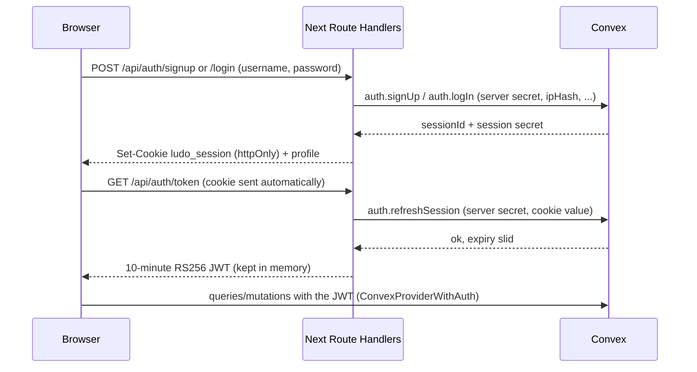

# Multiplayer: accounts, ranked queues, rating, history, spectators

How the optional account system and ranked play work on top of the anonymous
room-code game. Anonymous play, private code rooms and vs-computer games are
unchanged and never rated. For the version/reconnect model, metrics and load
tests see [operations.md](operations.md).

## Auth model

Accounts are custom username + password, stored in Convex. No auth library and
no third-party identity provider.

- **Passwords**: PBKDF2-HMAC-SHA256 via Web Crypto, 600,000 iterations, a
  random 16-byte salt per account. Usernames are 3–20 characters of
  `[a-z0-9_]` (stored lowercased, unique); passwords are 8–256 characters.
- **Sessions**: the `ludo_session` cookie holds `<sessionId>.<secret>`. It is
  `HttpOnly`, `SameSite=Lax`, `Path=/`, `Secure` in production, and lasts 30
  days. Convex stores only a SHA-256 hash of the secret
  (`authSessions.tokenHash`). Each token refresh slides the expiry back to 30
  days (a database write at most once a day), so a device used regularly stays
  signed in.
- **Convex identity**: page JavaScript cannot read the cookie, so
  `ConvexClientProvider` asks `/api/auth/token` for a short-lived JWT
  (`sub` = account id, `sid` = session id). Convex verifies it through
  `convex/auth.config.ts` (custom JWT provider, JWKS from the `AUTH_JWKS` env
  var). `requireAccount` / `optionalAccount` (`convex/lib/auth.ts`) also check
  that the `sid` session still exists and its `credentialVersion` is current,
  so logout and password changes take effect immediately, not after the JWT
  expires.
- **Server secret and client IP**: Convex functions called over the WebSocket
  cannot see the caller's IP. Signup, login, password change and logout
  therefore go through Next.js Route Handlers
  (`src/app/api/auth/{signup,login,password,logout,token}/route.ts`), which
  read the IP from `x-forwarded-for` (first hop) or `x-real-ip`, hash it, and
  call Convex actions that require `AUTH_SERVER_SECRET` (compared in constant
  time). Raw IPs are never stored. State-changing routes are `POST` with JSON
  and require a same-origin `Origin` header.
- **Rate limits** (fixed windows in `authAttempts`, `convex/lib/rateLimit.ts`).
  They are checked before hashing as a cheap reject, then re-checked and
  incremented in the transaction that would create the session, so concurrent
  attempts are counted exactly once each:

  | Key | Limit | On trip |
  | --- | --- | --- |
  | IP + username | 5 failures / 15 min | locked 15 min; reset on success |
  | IP | 30 failures / 15 min | locked 15 min |
  | Username (any IP) | 20 failures / 15 min | locked 15 min |
  | Signups per IP | 5 / hour | rejected |
  | New sessions per account | 5 / 10 min | rejected |

  A locked key rejects even a correct password. Unknown usernames still run a
  dummy hash, and errors are generic (`invalidCredentials`, or
  `tooManyAttempts` with a retry time), so responses do not reveal whether an
  account exists. An account keeps at most 10 active sessions (the oldest is
  revoked).
- **Password change** requires the current password (same limits as login),
  rehashes with a fresh salt, bumps `credentialVersion`, deletes every session
  of the account, and issues one new session for the caller. Other devices are
  signed out.
- **Secret hygiene**: credential reads are internal functions only, and every
  public query/mutation has a `returns` validator that whitelists safe fields.
  `tests/convex/auth-secrets.test.ts` calls every public function of auth,
  profiles, matchmaking, history, spectate and rooms and scans the results for
  hashes, salts, tokens and client ids.
- **Remembered device**: on load the provider fetches a token with the cookie,
  so a valid session signs in with no form. The profile `displayName` prefills
  the Create/Join name fields and is used as the seat name. After logout or
  expiry the login form prefills the last username from the non-secret
  `ludo_last_username` cookie. Passwords are never stored client-side.
- **Seats**: the account is device-wide, but seat ids stay per tab
  (`src/lib/player.ts`). Seats taken while signed in record
  `players.accountId`; such a seat can only be reclaimed by the same account.

## Queue lifecycle

Three ranked queues (`convex/lib/matchmaking.ts`):

| Queue | Players | Mode |
| --- | --- | --- |
| `duel` | 2 | 1v1 |
| `ffa4` | 4 | free-for-all |
| `team2v2` | 4 | 2v2 teams |

1. **Join** (`matchmaking.joinQueue`, signed-in only): inserts one
   `matchQueue` ticket per account with the profile's current rating. Joining
   again returns the same ticket (switching queue resets its wait time). If the
   account is already in an unfinished ranked game, that game is returned as
   `inGame` instead of a new ticket.
2. **Wait**: the client pings (`queuePing`) while searching and watches
   `queueStatus`. A waiting ticket with no ping for 20s counts as gone.
3. **Match**: `matchmaking.matchmake` runs after every join, and the
   `matchmaking sweep` cron schedules it for every queue every 10s as a safety
   net. One run reads up to 64 waiting tickets, forms up to 8 groups
   (`formGroups`), creates each started room with `createStartedRoom`
   (`convex/lib/roomFactory.ts`), and marks the tickets `matched` in the same
   transaction. Convex OCC on the ticket reads guarantees a ticket is matched
   at most once, even when runs overlap.
4. **Leave** (`leaveQueue`): deletes a waiting ticket; with no ticket it is a
   no-op. If the matcher already seated the player, it returns
   `{ status: "matched", roomId }` and the client goes to the game.
5. **Cleanup**: `cleanup.tick` (30s cron) drops stale waiting tickets and
   matched tickets whose game is over. A matched player who never arrives falls
   under the normal away / forfeit / turn-timeout flow.

Ranked rooms (`rooms.ranked = true`, `rooms.queue`) have no rematch, kick or
add-bot. The account that owns a seat reclaims it from any tab without host
approval. If that seat heartbeated in the last 15s, a second tab gets "already
playing in another tab" instead of taking it.

2v2 seats are snake-drafted by rating: 1st + 4th vs 2nd + 3rd.

## Rating formula

Pure functions in `convex/lib/rating.ts`:

- Everyone starts at **1200**. Ratings never drop below **100**.
- K factor: **40** for a player's first 30 rated games, then **24**.
- Expected score: `E(a, b) = 1 / (1 + 10^((b - a) / 400))`.
- **Duel / free-for-all**: pairwise Elo over the final placements. Each pair
  scores 1 / 0 (0.5 for equal placements), and the summed delta is scaled by
  `1 / (n - 1)` so a 4-player game moves ratings about as much as a duel. With
  four equal players the deltas are +20 / +7 / −7 / −20.
- **2v2**: team-average ratings, and the team result is applied to both
  members.
- Leavers and forfeits are ranked last by the game reducer, so abandoning a
  game loses rating.

**Rating-aware matching**: each ticket's acceptance window starts at ±100 and
widens by 50 for every 10s waited, up to ±500. The oldest ticket anchors a
group, and a candidate joins only if every pair in the group is inside both
members' windows. An anchor that cannot fill a group does not block younger
tickets.

## Settlement and idempotency

`settleRankedRoom` (`convex/lib/settlement.ts`) runs inside `commitEvents`,
right after `materializeState`, only when a ranked room moves from `playing` to
`finished`. It is in the same transaction as the commit that finished the game,
so a rating change can never exist without the finished game, or the other way
round.

- It reads the final `GameState` and the seats, never the event log, and writes
  nothing to `gameEvents` or the game state. Replay (`verifyReplay`) is
  unaffected.
- **Idempotent**: it returns early if `rooms.ratingSettledAt` is set, and it is
  set in the same transaction. The history write is also guarded by the
  `matches.by_room` index (one match row per room).
- **Void games**: a game finished as `abandoned`, a 2v2 with no winning team,
  or a game with fewer than two rated accounts is settled with no rating change.
  It still appears in history as unrated. Ranked rooms deleted by cleanup while
  still `playing` are never rated.
- Profiles get `rating`, `peakRating`, `ratedGames`, `gamesPlayed`, `wins` and
  `lastActiveAt` updated for rated games.

## Match history

Settlement writes one `matches` row and one `matchParticipants` row per account
(placement, rating before / after, delta). These are self-contained snapshots
(names, colours, queue, end reason) with no dependency on the room, so they
survive room cleanup (`deleteRoomCascade`, the 6h finished TTL).

Finished private code rooms are recorded too (`kind: "private"`, `rated: false`,
delta 0, real winner kept). A private room can rematch, so it gets one row per
finished game; ranked rooms stay at one row per room. Abandoned private games
are not recorded. Rows written before `kind` existed read as `"ranked"`.

`convex/history.ts`:

- `listMine`: the signed-in account's matches, newest first, paginated (empty
  for anonymous callers).
- `getMatch`: one match with all participants.
- `getRoomResult`: the rating result for a finished ranked room (the post-game
  banner in `GameScreen`).
- `leaderboard`: top accounts by rating (default 20, max 50); accounts with no
  rated games are skipped.

History rows expose usernames and display names only, never account ids, client
ids or room ids. The UI shows history and the leaderboard on `/profile` and a
rating-change banner on the finished ranked game screen.

## Spectator model

`convex/spectate.ts`:

- `listLive`: ranked games in `playing`, with player names, ratings and watcher
  counts. Lobbies and vs-computer rooms are not listed. Private code rooms can
  be watched only by someone who has the code.
- `getSpectatorRoom`: the same public room bundle players see, built with no
  session (no `isMe`, no client ids), plus the watcher count. Returns null for
  vs-computer rooms.
- `joinSpectate` / `spectatorPing` / `leaveSpectate`: idempotent rows in
  `spectators`, capped at 50 live watchers per room. `spectatorId` is never
  returned.

Watchers are never seated. Every gameplay, chat, voice and metrics mutation
already requires a seat (`requirePlayer` and friends), so watchers cannot act,
and watching never touches the room, its players or the event log (`eventSeq`
does not move). A tab seated in the room is refused as a watcher and offered a
link to its seat. `cleanup.tick` reaps watchers silent for 45s, and
`deleteRoomCascade` removes a room's watcher rows. Because queries cannot read
the clock, a watcher count can lag by up to about 75s.

The UI route `/spectate/[code]` renders `GameScreen` in read-only mode
(Spectating badge, watcher count, no controls, no seat heartbeats). The Play
Online menu has a "Watch live" list and watch-by-code.

## Deploy

The schema change is additive: the new tables (`accounts`, `profiles`,
`authSessions`, `authAttempts`, `matchQueue`, `matches`, `matchParticipants`,
`spectators`) are new, and the new fields on existing tables
(`rooms.ranked`, `rooms.queue`, `rooms.ratingSettledAt`, `players.accountId`)
are optional. Existing rooms and players keep working and **no backfill or
migration is needed**.

1. Generate keys: `node scripts/generate-auth-keys.mjs`.
2. Set `AUTH_JWKS` and `AUTH_SERVER_SECRET` on the Convex deployment
   (`npx convex env set ...`) **before** pushing. Convex refuses to push
   `convex/auth.config.ts` while `AUTH_JWKS` is missing.
3. Deploy the backend: `npx convex deploy`.
4. Set `AUTH_JWT_PRIVATE_KEY` and the same `AUTH_SERVER_SECRET` in the Next.js
   env (Vercel / `.env.local`) and deploy the frontend.

If the Next.js values are missing, anonymous play still works and the sign-in
routes return 503.
