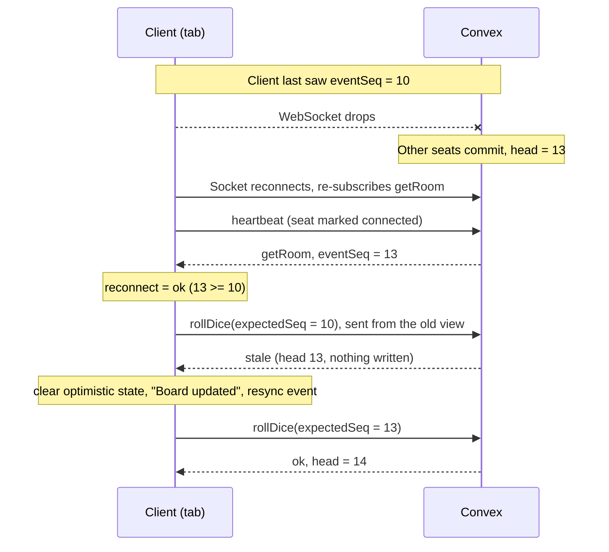

# Operations

How the multiplayer backend stays consistent, how to load test it, what the
metrics mean, and what to check when something looks wrong.

## Version model

Every room has one state version: `rooms.eventSeq`. It is the sequence number
of the newest row in that room's `gameEvents` log. There is no separate
`stateVersion` field.

- `game:rollDice`, `game:moveToken` and `game:passTurn` take `expectedSeq`. The
  client sends the `room.eventSeq` it is looking at.
- `commitEvents` (`convex/lib/gameStore.ts`) rejects the call with
  `GameError.staleAction` when `expectedSeq` differs from the head, and checks
  that the newest stored event matches the head (`assertTailMatchesHead`).
- A commit must advance the head (`newHead > head`); an empty commit throws.
  The head therefore only ever increases, including across rematches, which
  append to the same log instead of resetting it.
- Scheduled jobs (`handleTurnTimeout`, `playBotTurn`) carry the head they were
  scheduled at and exit without writing if the head has moved.
- `turnId` is a second staleness check on turn-scoped calls.
- Lifecycle mutations (`startGame`, `leaveRoom`, `kickPlayer`, `rematch`, and
  forfeits from `cleanup.tick`) are not version-checked. They are validated by
  room status and permissions, and they still advance the head when they commit
  events.

A rejected mutation rolls back every write it made. Stale rejections are
recorded only by the `mutation_rejected` log line written in `rejectStale`,
which includes `headSeq`, `expectedSeq` and the reason.

Replay is deterministic: `internal.gameEvents.verifyReplay` replays a room's log
and compares the result with the live state. `gameEvents.listEvents({ afterSeq })`
returns only the events after a given version, for incremental catch-up.

## Reconnect model

The Convex client reconnects its WebSocket on its own and re-subscribes
`rooms:getRoom`, so the board always converges on the server's state. The app
adds three things on top of that:

- **Presence** (`src/hooks/useRoomPresence.ts`): heartbeat every 20s,
  `markDisconnected` on `pagehide`, and an extra heartbeat when the tab becomes
  visible again or the browser fires `online`. The server ignores heartbeats
  less than 5s after the previous one (`HEARTBEAT_MIN_INTERVAL_MS`), even for a
  seat that was just marked away, so the hook sends a second heartbeat just
  after that window. `cleanup.tick` (every 30s) marks a seat away after 45s
  without a heartbeat.
- **Connection tracking** (`src/hooks/useConnectionResync.ts`): subscribes to
  `ConvexReactClient.subscribeToConnectionState`. While the socket is down,
  `GameScreen` disables roll and move. On reconnect it sends a heartbeat and
  records one `reconnect` client event: `ok` once the room view is at or past
  the last head seen before the drop, `error` if the heartbeat fails or the
  socket drops again first.
- **Stale auto-resync** (`GameScreen`): when a call comes back as stale, the
  subscription already holds the newer state. The screen clears optimistic
  tokens and local dice, shows "Board updated", and records a `resync` event.
  The player does not need to refresh.



Tests that cover this model: `tests/convex/versioning.test.ts`,
`reconnect-convergence.test.ts`, `room-isolation.test.ts` and
`concurrency/reconnect-storm.test.ts`.

## Observability

### Where the numbers come from

| Source | Written by | Contains |
| --- | --- | --- |
| Server samples | Successful gameplay and presence mutations (`recordSample`) | Count per kind. No latency. |
| Client samples | Browser `OpsReporter` and the k6 harness, via `ops:reportClientEvents` | Outcomes and end-to-end latency, including rejections. |
| Convex logs | `logEvent`, `withOutcomeLogging`, `rejectStale` | `mutation_ok` / `mutation_rejected` with `fn`, `code`, `headSeq`, plus lifecycle events. |

Rejected mutations cannot store their own metric (their writes roll back), so
rejections become metrics only when the client reports them. Latency
percentiles are client-observed end-to-end times. Time spent inside a mutation
is not reported as latency.

### Pipeline

- `opsSamples`: raw rows, one insert per sample. Nothing in the gameplay path
  patches a shared counter row.
- `ops:rollup` (cron, every minute) folds complete minutes into `opsMinute`
  (count plus a fixed log-scale latency histogram per minute, kind, outcome and
  source), deletes the raw rows it folded in the same transaction, snapshots
  `opsGauges` (active rooms, active players, connected players), and keeps 24h
  of history. If a run hits its 2,000-row batch it reschedules itself.
- `opsErrors`: the newest 200 client-reported `rejected` / `error` events.

Labels are fixed whitelists in `convex/lib/metrics.ts`:

- `kind`: `roll`, `move`, `pass`, `join`, `create`, `start`, `leave`,
  `heartbeat`, `reconnect`, `resync`, `timeout`, `bot`
- `outcome`: `ok`, `stale`, `rate_limited`, `rejected`, `error`

Room ids, client ids and room codes never become labels.

`ops:reportClientEvents` requires a seated, non-bot player, accepts at most 50
events per call, clamps latency to 0–60,000 ms, and accepts one batch per player
every 5s (later batches return `accepted: 0` and the browser retries on its next
15s flush).

### Dashboard (`/ops`)

- Enabled in development, or in production when
  `NEXT_PUBLIC_ENABLE_OPS_DASHBOARD=1`.
- The `ops:dashboard` query also requires a token that matches the
  `OPS_DASHBOARD_TOKEN` Convex environment variable. Set it with
  `npx convex env set OPS_DASHBOARD_TOKEN <value>`. The page asks for it once
  and keeps it in `sessionStorage`.
- Shows the last 60 minutes: active rooms and players, mutations per minute,
  p50/p95/p99 by kind, error rate, reconnect success rate, stale rejections,
  resyncs, and the 20 most recent errors. With no stored data it shows
  "no data".

### Metric definitions

- **Mutations per minute**: server samples, so successful mutations only.
- **Latency p50/p95/p99**: estimated from client histograms, per kind.
  Accuracy is limited by the bucket bounds (5, 10, 25, 50, 75, 100, 150, 250,
  400, 600, 1000, 1500, 2500, 4000, 6000, 10000, 15000, 30000, 60000 ms).
- **Error rate**: client `rejected` + `error` divided by client calls. Stale and
  rate-limited results are counted separately, and `resync` / `reconnect`
  events are not calls.
- **Reconnect success rate**: client `reconnect` events with outcome `ok`
  divided by all client `reconnect` events. The server's own `reconnect` count
  (a heartbeat that brings an away seat back) is shown separately.
- **Stale rejections**: client calls rejected because the view was outdated.
  Some are normal with several tabs or slow networks.
- **Resyncs**: times the client recovered from a stale rejection.

## Load testing

The k6 scripts drive the real Convex functions over the public HTTP API
(`POST /api/mutation` and `/api/query`). They are meant for a local backend; do
not point them at production.

```bash
winget install k6                 # once
npx convex dev                    # local backend on http://127.0.0.1:3210
npm run load:gameplay             # steady gameplay
npm run load:reconnect            # reconnect storm
npm run load:verify               # verifyReplay on a sample of rooms
```

Pass settings with `-e`, for example
`k6 run -e ROOMS=25 -e LABEL="my laptop" load/k6/gameplay.js`. Create
`load/results/` first (`npm run load:results-dir`) when calling k6 directly.

| Variable | Default | Meaning |
| --- | --- | --- |
| `CONVEX_URL` | `http://127.0.0.1:3210` | Backend URL |
| `ROOMS` | 5 | Virtual users; one room each |
| `PLAYERS_PER_ROOM` | 4 | 2–4 seats per room, all driven by the same VU |
| `DURATION` | `2m` | Test length |
| `MAX_ACTIONS` | 600 | Actions per room before starting a new room |
| `THINK_MS` | 250 | Pause between actions (server minimum is 100ms) |
| `HEARTBEAT_MS` | 15000 | Heartbeat cadence per seat |
| `STORMS` | 3 | Reconnect storms per room (`reconnect.js`) |
| `REPORT_CLIENT_METRICS` | 1 | Send client events to `ops:reportClientEvents` |
| `P95_MS` / `P99_MS` | 500 / 1000 | Mutation latency thresholds |
| `MAX_ERROR_RATE` | 0.01 | Unexpected error threshold |
| `MIN_RECONNECT_SUCCESS` | 0.99 | Reconnect success threshold |
| `LABEL` | (empty) | Free text stored in the summary, e.g. the machine |

- `gameplay.js` plays legal moves in every seat until the match ends or
  `MAX_ACTIONS` is reached.
- `reconnect.js` lets the turn move on, then for every seat: `markDisconnected`,
  a roll from the outdated view (must be rejected as `stale`), a `getRoom`
  resync (must reach the head), a heartbeat, and finally one action at the
  fresh `eventSeq`. Expected stale results do not count as errors.
- k6 metrics: `mutation_latency` and `query_latency` (trends tagged by `fn`),
  `mutations` (counter), `errors` (rate), `stale_rejections` (counter),
  `reconnect_success` (rate), `active_rooms` and `active_players` (gauges).
- Each run writes a JSON summary to `load/results/` (gitignored).
- `load:verify` takes an optional sample size (default 20). Environment:
  `DEPLOYMENT` (default `local`), `POOL` (rooms to sample from, default 200),
  `ORDER` (`desc` for newest, `asc` for oldest).

### Measured results

Measured on 2026-10-03. Machine: Intel Core i5-13500H (12 cores, 16 threads),
15.7 GB RAM, Windows 11 Home. The local Convex backend, k6 v2.2.0 and the
editor all ran on the same laptop. All runs used 4 players per room, 2 minutes,
`THINK_MS=250`, `HEARTBEAT_MS=15000`, `MAX_ACTIONS=600`, client metrics on, and
the default thresholds.

| Script | Rooms | Mutations/s | Mutation p50 / p95 / p99 (ms) | Query p95 (ms) | Errors | Stale rejections | Reconnect success | Thresholds |
| --- | --- | --- | --- | --- | --- | --- | --- | --- |
| gameplay | 5 | 6.22 | 321 / 1379 / 2881 | 619 | 0.00% (0/1441) | 0 | n/a | Fail (latency) |
| reconnect | 5 | 4.46 | 462 / 1752 / 3149 | 1031 | 0.10% (1/959) | 120 | 100% (120/120) | Fail (latency) |
| gameplay | 25 | 11.46 | 1136 / 4713 / 6815 | 3460 | 0.25% (5/1981) | 0 | n/a | Fail (latency) |
| reconnect | 25 | 24.47 | 473 / 2109 / 3238 | 1163 | 0.00% (0/5475) | 686 | 100% (660/660) | Fail (latency) |

- 50 and 100 rooms: not measured. The step-up stopped at 25 because the latency
  thresholds already failed at 5 rooms.
- The error and reconnect thresholds passed in every run. The few errors were
  HTTP 503s and "Function execution timed out (maximum duration: 1s)" from the
  backend, not game rejections.
- Correctness held under load: every outdated-view call in the storms was
  rejected as `stale`, every resync reached the head, every seat was connected
  after its heartbeat, and every follow-up action succeeded. `verifyReplay`
  passed for 40 of 40 sampled rooms (newest 20 and oldest 20, heads up to 292,
  playing and finished).
- Cloud Convex: not measured.

### What limited latency in these runs

From a Convex log capture during a 5-room run
(`load/results/profile-5r-60s-convex-logs.jsonl`, about 4.6 minutes of
completions):

- Server execution time matched the client latency (for example `rollDice`
  median about 360ms inside the backend), so the time went to the local backend,
  not the network. Read-only calls were slow too, which points at the laptop
  backend's capacity rather than write contention.
- Calls from k6 used about 39% of backend execution time. Scheduled functions
  used 37% and crons 24%: `playBotTurn` 22%, `handleTurnTimeout` 15%,
  `cleanup:tick` 13%, `ops:rollup` 11%.
- Optimistic concurrency conflicts hit only background functions
  (`playBotTurn`, `cleanup:tick`, `ops:rollup`), mostly on `players` rows written
  by `reportClientEvents`, `heartbeat` and `rollDice`. No player-facing mutation
  retried.

Observations, documented without changing the code:

1. Every commit schedules both `handleTurnTimeout` and `playBotTurn`, even in
   rooms with no bots. Most of those runs exit early, but they still cost about
   four background executions per human action.
2. `cleanup:tick` scans all rooms with unbounded `.collect()` calls in one
   mutation. Under load it hit the execution limit, so cleanup stops making
   progress when there are many rooms. Abandoned load-test rooms also keep
   timing out every 30s until cleanup removes them, which raised idle backend
   CPU from 0.3 to 3.4 CPU-seconds per 10s after the runs.
3. `reportClientEvents` patches `players.lastMetricsAt`, which conflicts with
   background reads of the same rows. It is rate-limited to once per 5s per
   player.

These are candidates for future work. Measure on a cloud deployment before
changing the architecture.

## Troubleshooting

Read logs with `npx convex logs` (add `--prod` for production), or in the Convex
dashboard. Log lines are JSON with an `event` field.

**Stale rate rising**

- Some stale results are expected (several tabs, slow phones, a timeout firing
  while a player taps). A steady climb usually means clients are acting on old
  views.
- Look for `"event":"mutation_rejected","code":"stale"`. Compare `expectedSeq`
  with `headSeq`: a gap of 1–2 is a race, a large gap is a client that stopped
  receiving updates.
- Check that resyncs on the dashboard track stale rejections. If stale grows
  but resyncs do not, the auto-resync path in `GameScreen` is not running.

**Reconnect failures**

- Client `reconnect` errors carry the message "Reconnect heartbeat failed" or
  "Disconnected again before resync" in the recent errors list.
- Seats that stay away after returning: the server ignores heartbeats within 5s
  of the previous one. Check for `player_reconnected` and `player_disconnected`
  log lines for the room.
- Compare server reconnects with client reconnects. Server reconnects without
  client ones usually mean the reporter is not flushing (it flushes every 15s
  and on `pagehide`).

**Rollup backlog**

- Symptom: dashboard lags behind, or `opsSamples` keeps growing. Check row
  counts with `npx convex data opsSamples --limit 5`.
- `ops:rollup` returns `{ folded, backlog }`. Run it by hand with
  `npx convex run ops:rollup` and repeat while `backlog` is true.
- "Skipping N run(s) of job ... because multiple scheduled runs are in the
  past" means the backend is overloaded, not that rollup is broken.

**`verifyReplay` diffs**

- Run `npx convex run gameEvents:verifyReplay '{"roomId":"<id>"}'`, or
  `npm run load:verify` for a sample.
- Any diff means live state and the event log disagree. Keep the room (do not
  let cleanup delete it), open `/debug/replay/<CODE>`, and find the first event
  where they diverge.
- Check for `commitEvents: head must advance` errors and tail/head mismatches in
  the logs.

**Useful log queries**

- `"event":"mutation_rejected"`: all rejections, with `fn` and `code`.
- `"code":"rate_limited"`: clients acting faster than the 100ms action
  interval.
- `"event":"room_cleaned"`: rooms removed by cleanup.
- `"Function execution timed out"`: backend overloaded or a function doing too
  much work in one transaction.
